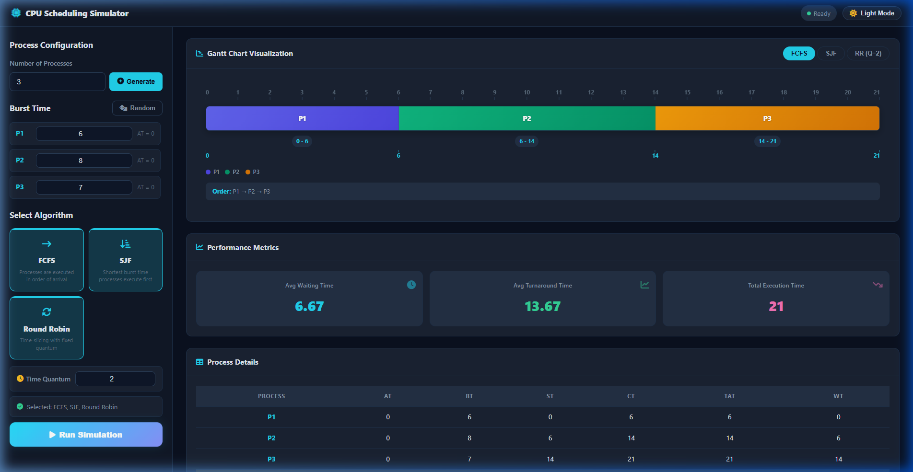
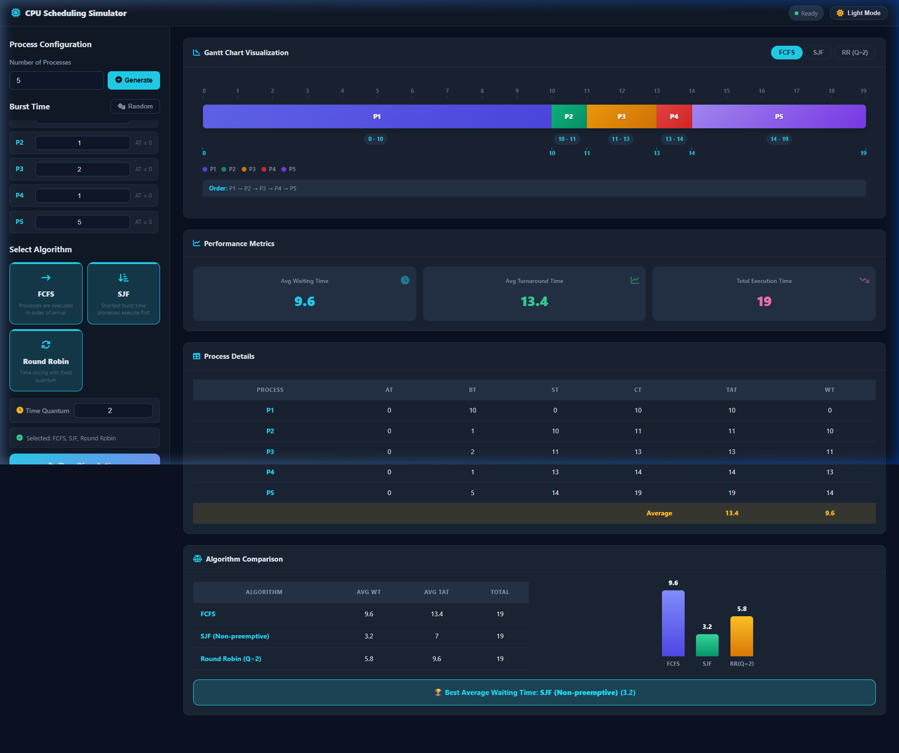
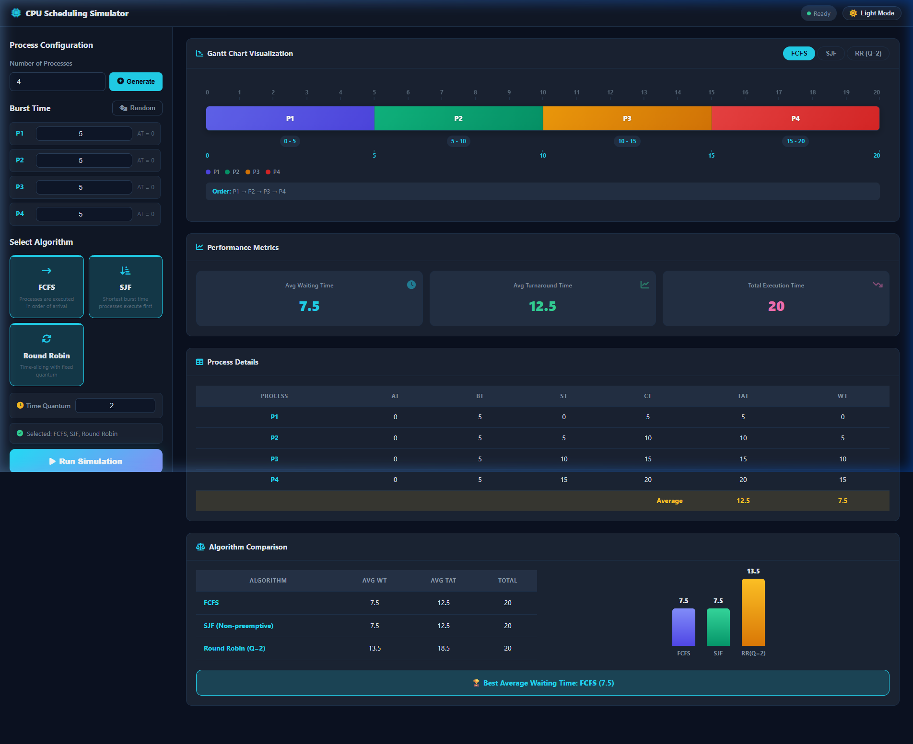
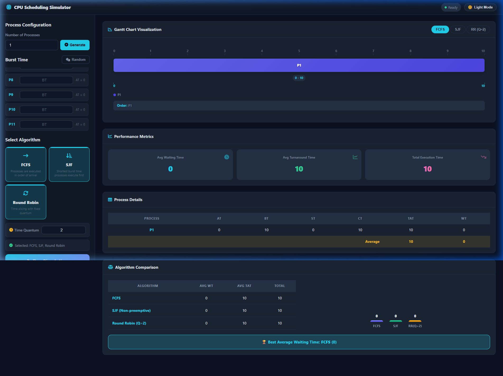

# ⚙️ CPU Scheduling Simulator

A modern, responsive web application for simulating and comparing CPU Scheduling algorithms, built with vanilla HTML, CSS, and JavaScript.

## 🚀 Features

- **Algorithms Supported:**
  - **FCFS** (First-Come, First-Served)
  - **SJF** (Shortest Job First - Non-preemptive)
  - **Round Robin** (RR with configurable Time Quantum, default $Q = 2$)
- **Simulation Setup:**
  - Configurable number of processes ($P_1$ to $P_n$)
  - All processes have Arrival Time ($AT = 0$)
  - Manual Burst Time ($BT$) input or 🎲 Randomizer
- **Visualizations & Analytics:**
  - **Precision-Aligned Gantt Chart:** Timeline ruler, time range badges, boundary timestamps, process legend, and execution order.
  - **Performance Metrics:** Average Waiting Time ($WT$), Average Turnaround Time ($TAT$), and Total Execution Time.
  - **Process Details Table:** Detailed breakdown of $AT$, $BT$, $ST$, $CT$, $TAT$, and $WT$ per process.
  - **Algorithm Comparison:** Side-by-side performance table, comparative bar chart, and best algorithm indicator.
- **UI/UX:**
  - Dark Mode & Light Mode toggle with local persistence.
  - Sleek dashboard interface inspired by modern developer tooling.

---

## 📦 วิธีติดตั้งและเปิดใช้งานโปรแกรม

### ข้อกำหนดเบื้องต้น (Prerequisites)

- **Web Browser** ที่รองรับ ES6+ เช่น Google Chrome, Mozilla Firefox, Microsoft Edge หรือ Safari เวอร์ชันล่าสุด
- **ไม่จำเป็น**ต้องติดตั้ง Node.js, npm หรือ build tool ใด ๆ — โปรเจกต์นี้ใช้ Vanilla HTML/CSS/JS ทั้งหมด

### ขั้นตอนการติดตั้ง

1. **Clone หรือ Download โปรเจกต์**

   ```bash
   # Clone ด้วย Git
   git clone https://github.com/<your-username>/Cpu-Scheduling-Simulator.git
   cd Cpu-Scheduling-Simulator

   # หรือ Download ZIP แล้วแตกไฟล์
   ```

2. **เปิดไฟล์ `index.html` ในเว็บเบราว์เซอร์**

   ```bash
   # Windows
   start index.html

   # macOS
   open index.html

   # Linux
   xdg-open index.html
   ```

3. **หรือใช้ Live Server (แนะนำสำหรับนักพัฒนา)**

   - ติดตั้ง Extension **Live Server** ใน VS Code
   - คลิกขวาที่ไฟล์ `index.html` → เลือก **"Open with Live Server"**
   - เว็บแอปจะเปิดที่ `http://127.0.0.1:5500` โดยอัตโนมัติ

### วิธีใช้งาน

1. กรอก **จำนวน Process** (1–20) แล้วกด **Generate**
2. กรอก **Burst Time** ของแต่ละ Process หรือกดปุ่ม 🎲 **Random** เพื่อสุ่มค่า
3. เลือก **อัลกอริทึม** ที่ต้องการ (FCFS, SJF, Round Robin) — สามารถเลือกได้หลายตัวพร้อมกัน
4. สำหรับ Round Robin ให้กำหนดค่า **Time Quantum** (ค่าเริ่มต้น = 2)
5. กดปุ่ม ▶ **Run Simulation** เพื่อดูผลลัพธ์

---

## 🧰 เครื่องมือและ Version ที่ใช้ในการพัฒนา

| เครื่องมือ / เทคโนโลยี | Version | รายละเอียด |
|---|---|---|
| **HTML5** | — | โครงสร้างหน้าเว็บ (Semantic HTML) |
| **CSS3** | — | จัดรูปแบบ UI, Dark/Light Theme, Responsive Layout |
| **JavaScript (ES6+)** | — | ตรรกะอัลกอริทึม, DOM Manipulation, LocalStorage |
| **Font Awesome** | 6.5.1 | ไอคอนต่าง ๆ ใน UI (ใช้ผ่าน CDN) |
| **Visual Studio Code** | 1.96+ | Code Editor หลักในการพัฒนา |
| **Live Server** (VS Code Extension) | 5.7+ | Development Server สำหรับ Auto-reload |
| **Git / GitHub** | — | Version Control และ Collaboration |
| **Google Chrome DevTools** | — | Debug, Inspect Element, Performance Testing |

### โครงสร้างไฟล์โปรเจกต์

```
Cpu-Scheduling-Simulator/
├── index.html      # หน้าหลักของแอปพลิเคชัน
├── style.css       # สไตล์ทั้งหมด (Dark/Light Theme)
├── script.js       # ตรรกะอัลกอริทึมและ UI Logic
├── README.md       # เอกสารโปรเจกต์ (ไฟล์นี้)
└── .gitignore      # ไฟล์ที่ไม่ต้องการ Track ใน Git
```

---

## 🧪 ตัวอย่างข้อมูลสำหรับทดสอบ (Test Cases)

### Test Case 1 — Basic (3 Processes)

| Process | Arrival Time (AT) | Burst Time (BT) |
|---|---|---|
| P1 | 0 | 6 |
| P2 | 0 | 8 |
| P3 | 0 | 7 |

**ผลลัพธ์ที่คาดหวัง:**

| Algorithm | Avg Waiting Time | Avg Turnaround Time | Total Execution Time |
|---|---|---|---|
| FCFS | 7.00 | 14.00 | 21 |
| SJF | 6.33 | 13.33 | 21 |
| RR (Q=2) | 12.33 | 19.33 | 21 |

**ภาพผลลัพธ์จากโปรแกรม:**



### Test Case 2 — Varied Burst Times (5 Processes)

| Process | Arrival Time (AT) | Burst Time (BT) |
|---|---|---|
| P1 | 0 | 10 |
| P2 | 0 | 1 |
| P3 | 0 | 2 |
| P4 | 0 | 1 |
| P5 | 0 | 5 |

**ผลลัพธ์ที่คาดหวัง:**

| Algorithm | Avg Waiting Time | Avg Turnaround Time |
|---|---|---|
| FCFS | 7.60 | 11.40 |
| SJF | 3.20 | 7.00 |
| RR (Q=2) | 8.60 | 12.40 |

**ภาพผลลัพธ์จากโปรแกรม:**



> 💡 **หมายเหตุ:** SJF จะให้ค่า Average Waiting Time ต่ำที่สุดเสมอ เมื่อ Process ทุกตัวมี Arrival Time = 0

### Test Case 3 — Equal Burst Times (4 Processes)

| Process | Arrival Time (AT) | Burst Time (BT) |
|---|---|---|
| P1 | 0 | 5 |
| P2 | 0 | 5 |
| P3 | 0 | 5 |
| P4 | 0 | 5 |

**ผลลัพธ์ที่คาดหวัง:**

- FCFS และ SJF จะให้ผลลัพธ์เหมือนกัน (Avg WT = 7.50, Avg TAT = 12.50)
- ใช้ทดสอบว่าทั้งสองอัลกอริทึมให้ผลตรงกันเมื่อ BT เท่ากันหมด

**ภาพผลลัพธ์จากโปรแกรม:**



### Test Case 4 — Single Process

| Process | Arrival Time (AT) | Burst Time (BT) |
|---|---|---|
| P1 | 0 | 10 |

**ผลลัพธ์ที่คาดหวัง:**

- ทุกอัลกอริทึมต้องให้ WT = 0, TAT = 10, Total Execution = 10

**ภาพผลลัพธ์จากโปรแกรม:**



---

## 🤖 เครื่องมือ AI ที่ใช้ในการพัฒนา

### เครื่องมือ AI หลัก

| เครื่องมือ AI | วัตถุประสงค์ |
|---|---|
| **Google Gemini** | ใช้ในการ Generate โค้ด, Debug, และปรึกษาเรื่องการออกแบบอัลกอริทึม |
| **Antigravity (Google Deepmind)** | ใช้ในการ Pair Programming, ปรับปรุง README, และ Review โค้ด |

### ตัวอย่าง Prompt สำคัญที่ใช้

#### 1. Prompt สำหรับสร้างโครงสร้างโปรเจกต์

```
สร้างเว็บแอปพลิเคชัน CPU Scheduling Simulator ด้วย Vanilla HTML, CSS, JavaScript
ที่รองรับอัลกอริทึม FCFS, SJF (Non-preemptive), และ Round Robin
โดยผู้ใช้สามารถกำหนดจำนวน Process และ Burst Time ได้เอง
ทุก Process มี Arrival Time = 0
แสดงผลเป็น Gantt Chart, Performance Metrics, และตารางรายละเอียด
```

#### 2. Prompt สำหรับออกแบบ UI/UX

```
ออกแบบ UI แบบ Dashboard สไตล์ Modern Developer Tool
รองรับ Dark Mode และ Light Mode พร้อมบันทึกการตั้งค่าลง LocalStorage
ใช้ Font Awesome สำหรับไอคอน และ CSS Custom Properties สำหรับ Theming
Layout เป็นแบบ 2 คอลัมน์ (Left Panel = Config, Right Panel = Results)
```

#### 3. Prompt สำหรับ Gantt Chart

```
สร้าง Gantt Chart Visualization ที่แสดง:
- Timeline Ruler พร้อมหน่วยเวลา
- แต่ละ Process มีสีที่แตกต่างกัน
- แสดง Time Range Badge บนแต่ละ Block
- แสดง Boundary Timestamps ที่จุดเริ่มและสิ้นสุด
- มี Process Legend แสดงสีและชื่อ Process
- แสดง Execution Order ลำดับการทำงาน
```

#### 4. Prompt สำหรับ Algorithm Comparison

```
เพิ่มส่วน Algorithm Comparison ที่:
- แสดงตารางเปรียบเทียบ Avg WT, Avg TAT, Total Time ของทุกอัลกอริทึม
- แสดง Bar Chart เปรียบเทียบค่า Metrics แบบ Visual
- ระบุ Best Algorithm จาก Avg Waiting Time ต่ำสุด
- รองรับการเลือกเปรียบเทียบ 2-3 อัลกอริทึมพร้อมกัน
```

#### 5. Prompt สำหรับ Debug และ Edge Cases

```
ตรวจสอบและแก้ไข Edge Cases ต่อไปนี้:
- กรณี Process เดียว (n=1) ทุกอัลกอริทึมต้องให้ WT=0
- กรณี Burst Time เท่ากันหมด FCFS และ SJF ต้องได้ผลลัพธ์เหมือนกัน
- กรณี Time Quantum >= Max Burst Time, Round Robin ต้องทำงานเหมือน FCFS
- ตรวจสอบ Input Validation สำหรับค่าที่ไม่ใช่จำนวนเต็มบวก
```

---

## 👥 สมาชิกในกลุ่ม

- นาย พิธิพัฒน์ เจียง รหัส 1670706959 Sec 327F หน้าที่ การออกแบบและพัฒนาอัลกอริทึม
- นาย พัฒธิวัฒน์ เจียง รหัส 1670706967 Sec 327F หน้าที่ การออกแบบ User Interface
- นาย ธนกฤต พวงแก้ว รหัส 1670703998 Sec 327F หน้าที่ การออกแบบกรณีทดสอบ
- นาย ณัฐวุฒิ อุดมศักดิ์ รหัส 1670706975 Sec 327F หน้าที่ การออกแบบกรณีทดสอบ
